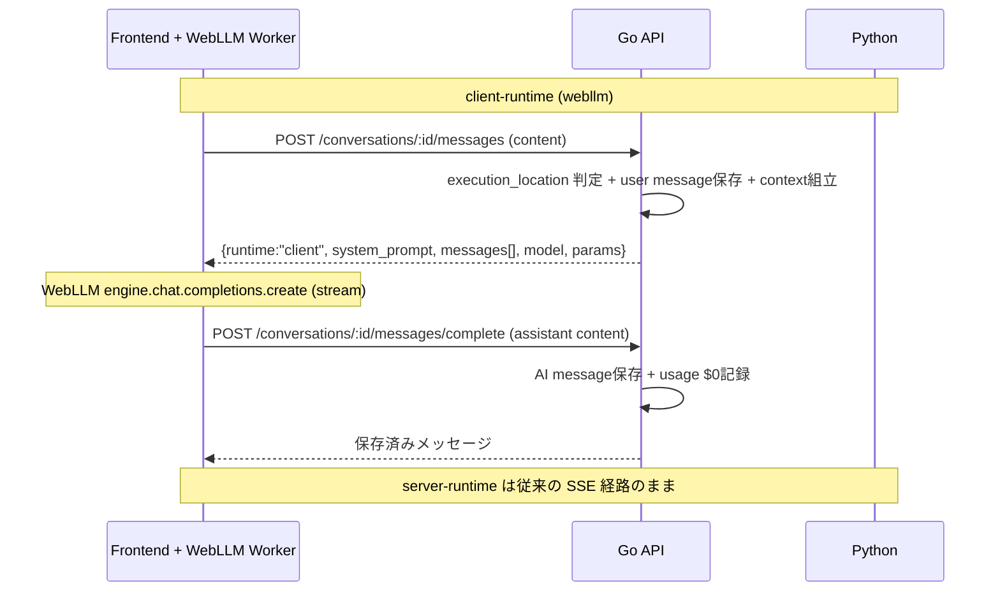

# ローカルLLM（WebLLM）ハイブリッド統合 実装ドキュメント

最終更新: 2026-07-02
対象リポジトリ: `NeuraKnot`
対象フェーズ: WebLLM をブラウザ実行の第4プロバイダー `webllm` として LLM レジストリへ統合（管理画面登録 / AI友達作成 / 基本チャット / 質問候補・プロンプト強化のローカル化）

---

## 1. このドキュメントの目的

ブラウザ上で動作するローカルLLM（[WebLLM](https://github.com/mlc-ai/web-llm)）を、既存の `llm_models` レジストリに「実行場所=クライアント」の新プロバイダーとして統合した変更を、将来追跡できる状態で記録する。

- 何を目的に、どの層に、どんな変更を入れたか
- 実行場所（`execution_location`）による推論経路の分岐設計
- 変更ファイル一覧（層ごと）
- 実施した検証と、残っている課題

---

## 2. 背景と到達点

### 背景

- クラウドLLM（OpenAI / Anthropic / Google）はトークン課金が発生し、利用量に比例してサーバーコストが増える。
- プライバシー重視・オフライン志向のユーザーに対し、データを外部送信しない選択肢を提供したい。
- 既存アーキテクチャはサーバー推論前提（Go → Python → クラウドLLM）で、クライアント推論の経路が存在しなかった。

### 到達点（今回）

- **WebLLM を新プロバイダー `webllm` として第一級市民化**。管理者は他LLMと同じ管理画面UIで追加でき、ユーザーはAI友達作成時に同じ選択UIで選べる。
- **実行場所（`execution_location`）で推論経路を分岐**。`server`（従来）は Python 推論、`client`（webllm）は Go が推論せず「材料」を返し、ブラウザの WebGPU/Web Worker で推論する。
- **推論だけローカル・保存はサーバーDB**。会話履歴・一覧・分析は従来どおり機能し、課金は $0 として記録される。
- 質問候補生成・プロンプト強化などの補助機能も、ローカルエンジンがロード済みなら $0 で実行し、失敗時はクラウドへ自動フォールバックする。

### 使用パッケージ

- `@mlc-ai/web-llm`（正式名。記事で見かける `@mlc.ai/web-llm` は誤り）
- エンジンは **Web Worker 版**（`CreateWebWorkerMLCEngine`）を使用し、重い推論をUIスレッドから分離。
- WebGPU ベースのため COOP/COEP ヘッダーは不要（`next.config.js` は無改修）。

---

## 3. アーキテクチャ

### 実行場所による分岐

| execution_location | provider                    | 推論の場所                       | 課金                     |
| ------------------ | --------------------------- | -------------------------------- | ------------------------ |
| `server`           | openai / anthropic / google | サーバー（Python + クラウドLLM） | トークン単価に応じて発生 |
| `client`           | webllm                      | ブラウザ（WebGPU / Web Worker）  | $0 記録                  |

`execution_location` は `llm_models` テーブルの列であり、モデル定義ごとに決まる。`webllm` は必ず `client`、それ以外は `server` になるよう Go ドメインの `Validate()` で強制する。

### client-runtime のシーケンス



ポイント：**client-runtime は Python に到達しない**。Go は推論せず「材料（system_prompt + 履歴 + パラメータ）」を返すだけで、実際の生成はブラウザで完結する。

---

## 4. DB 変更（マイグレーション `000012`）

`backend-go/migrations/000012_add_webllm_provider.{up,down}.sql` を新設。

### up の内容

1. `llm_models` に実行場所カラムを追加
   - `execution_location VARCHAR(20) NOT NULL DEFAULT 'server'`
   - CHECK 制約 `chk_llm_models_execution_location`：`IN ('server', 'client')`
2. provider の CHECK 制約を3テーブルで張り替え、`webllm` を許可
   - `llm_models.chk_llm_models_provider`
   - `ai_agents.chk_provider`
   - `llm_pricing.chk_pricing_provider`
   - いずれも `IN ('openai', 'anthropic', 'google', 'webllm')` に更新

WebLLM 固有情報は既存の `metadata` JSONB に格納する（新規カラムは増やさない）。

```json
{
  "mlc_model_id": "Llama-3.2-1B-Instruct-q4f32_1-MLC",
  "download_size_mb": 880,
  "vram_required_mb": 1128,
  "supports_tools": false
}
```

`model` 列には WebLLM の `prebuiltAppConfig.model_list` に存在するID（＝`mlc_model_id`）を入れる。

### down の内容

- 3テーブルの provider CHECK を元の3プロバイダーに戻す
- `execution_location` カラムと CHECK 制約を削除
- 注意コメント：`webllm` の行が残っていると CHECK 再作成に失敗するため、ロールバック前に該当行を削除すること

---

## 5. バックエンド（Go）変更

### 5.1 ドメイン層

- `internal/domain/ai/provider.go`
  - `ProviderWebLLM Provider = "webllm"` を追加。`IsValid()` に反映。
  - `IsClientRuntime()` ヘルパを追加（`webllm` のとき true）。
- `internal/domain/llmmodel/model.go`
  - `Model` 構造体に `ExecutionLocation string` を追加、`IsClientRuntime()` ヘルパを追加。
  - `ExecutionLocationServer` / `ExecutionLocationClient` 定数、`ErrInvalidExecutionLocation` を追加。
  - `NewModel` は `executionLocation` を受け取り（空なら `server`）、`Validate()` で `webllm`→`client` 固定、その他→`server` 固定を強制。

### 5.2 リポジトリ / ユースケース / DTO

- `internal/infrastructure/persistence/llm_model_repository.go`
  - `List` / `FindByID` / `FindByProviderAndModel` の SELECT、`Create` の INSERT、`Update` の UPDATE、`scanModel` に `execution_location` を追加。
- `internal/usecase/llmmodel/usecase.go`
  - `CreateModel` / `UpdateModel` のシグネチャに `executionLocation` を追加。
- `internal/handler/http/request/llm_model.go` / `response/llm_model.go`
  - リクエスト/レスポンス DTO に `ExecutionLocation` を追加。

### 5.3 チャットフロー分岐（prepare / complete）

- `internal/usecase/chat/client_inference.go`（新規）
  - `PrepareClientInference(ctx, userID, convID, content)`：会話所有者確認 → agent 検証 → **ユーザーメッセージ保存** → 履歴（過去20件）と system_prompt・パラメータを OpenAI 互換形式で組み立てて返す。**Python は呼ばない。**
  - `CompleteClientInference(ctx, userID, convID, assistantContent, promptTokens, completionTokens, processingTimeMs)`：**AIメッセージ保存** → 会話/エージェント統計更新 → セッション使用量を記録（`webllm` 単価は $0）。
- `internal/handler/http/chat_handler.go`
  - `SendMessage` に「`agent.Provider.IsClientRuntime()` なら prepare payload を返す」分岐を追加。
  - `CompleteClientInference` ハンドラを追加。
- `internal/handler/http/request/chat.go` / `response/chat.go`
  - `CompleteClientInferenceRequest`、`ClientInferenceMessage` / `ClientInferenceResponse` を追加。
- `internal/handler/http/router.go`
  - `POST /conversations/:id/messages/complete` を登録（`messages` と同じ認可）。
- 課金：client-runtime では利用上限のブロックを行わない（コスト削減の実装ポイント）。

### 5.4 コスト $0 の担保

`internal/usecase/usage/recorder.go` の `RecordSessionUsage` は `started_at` 時点の `llm_pricing` を引く。`webllm` に単価 $0 を登録すれば `cost = 0`、未登録でも警告のうえ `cost = 0` で保存されるため、いずれにせよ課金は発生しない。

---

## 6. フロントエンド変更

### 6.1 エンジン管理

- `frontend/lib/local-llm/webllm.worker.ts`（新規）：`WebWorkerMLCEngineHandler` を立てる Web Worker。
- `frontend/lib/local-llm/support.ts`（新規）：WebGPU サポート判定ユーティリティ。
- `frontend/lib/contexts/LocalLLMContext.tsx`（新規）：エンジンの状態（status / progress / currentModelId）をアプリ全体で保持する Context。`ensureEngine(modelId)` と `unload()` を提供し、チャット間移動でもエンジンを保持。
- `frontend/app/dashboard/DashboardLayoutClient.tsx`：`LocalLLMProvider` を配置。

### 6.2 送信ルーター

- `frontend/lib/api/chat-router.ts`（新規）：`sendChatMessage` が prepare POST → `runtime==="client"` なら WebLLM で `stream:true` 推論して各 delta を `{type:'token'}` に変換、完了で complete POST → `{type:'done'}`。`runtime==="server"` は従来の SSE 経路に委譲。既存の `StreamEvent` ハンドラをそのまま流用できるシグネチャ。
- `frontend/components/chat/AIChatWindow.tsx`：送信を `sendChatMessage` に差し替え。初回チャット時に WebGPU 判定 → DL確認 → エンジンロード（進捗バー）を行う `ensureLocalReady` を実装。client-runtime 時は課金チェックをスキップ。

### 6.3 管理ダッシュボードUI

- `frontend/components/admin/LLMModelsAdminModalClient.tsx`
  - プロバイダーに「ブラウザローカル (WebLLM)」を追加。
  - `webllm` 選択時：モデルIDを `prebuiltAppConfig.model_list` からのプルダウンで選ばせる（タイプミス防止）、`execution_location=client` 固定、単価は $0/無料表示、metadata（DLサイズ / VRAM 等）入力。
  - モデル一覧に「実行場所（サーバー/ブラウザ）」バッジ列を追加。
- `frontend/lib/actions/llm-models.ts`：`execution_location` / metadata を DTO に通す。
- `frontend/lib/types/llm-model.ts`：`execution_location` を型に追加。

### 6.4 AI友達作成 / 設定UI

- `frontend/components/friends/AddFriendsPanel.tsx` / `AgentSettingsModal.tsx`
  - `providerLabels` に `webllm` を追加。
  - `webllm` モデル選択時に「ローカル実行・無料・データ非送信」バッジを表示。
  - WebGPU 非対応なら選択不可＋理由表示（クラウド利用へ誘導）。

### 6.5 隔離ラボページ（Phase 0）

- `frontend/app/dashboard/settings/local-llm-lab/page.tsx`（新規）：本体に触る前に WebGPU 判定 → モデルDL（進捗バー）→ ストリーミング推論を単独で実証するための検証用ページ。`SettingsListSidebar` にリンクを追加。

---

## 7. 補助機能のローカル化（Phase 2）

`frontend/lib/local-llm/aux.ts`（新規）に WebLLM の JSONモードを使うヘルパを実装。

- `generateSuggestionsLocal(engine, recentMessages, count)`：質問候補生成。
- `enhanceSystemPromptLocal(engine, currentPrompt)`：システムプロンプト強化。

呼び出し側の分岐：

- `AIChatWindow.tsx` の `handleGenerateSuggestions`：ローカルエンジンがロード済みならローカル生成、失敗時はクラウド（`generateConversationSuggestedQuestions`）へフォールバック。
- `AddFriendsPanel.tsx` の `handleEnhancePrompt`：同様にローカル優先 → 失敗時はクラウド（`enhanceSystemPrompt`）へフォールバック。

効果：これら補助機能も webllm 利用時はサーバーコスト $0。

---

## 8. 実施した検証

Docker 開発環境（Postgres + backend-go + frontend コンテナ）で検証済み。

### マイグレーション

- `000012` を実DBに適用：`schema_migrations` version **11 → 12（clean）**。
- `down 1 → up` のラウンドトリップ成功（可逆性確認）。
- `execution_location` カラム（NOT NULL / default `'server'`）と CHECK 制約4件（実行場所 + 3テーブルの provider）が期待どおり。

### DBレベル e2e（prepare→complete フローを実データで再現）

1. `webllm` モデル登録（`execution_location=client`, metadata に `mlc_model_id`）+ 単価 $0 pricing
2. `webllm` AI友達 → 会話 → ユーザーメッセージ保存 → AIメッセージ保存 + セッション記録
3. **別接続で再取得（リロード相当）**：メッセージが永続化されて残存
4. **課金 $0**：`ai_chat_sessions.cost_usd = 0 / cost_jpy = 0`
5. 検証後、テストデータはクリーンアップ（version 12 は維持）

### アプリ稼働

- backend-go：WebLLM 変更込みでコンパイル → 起動成功。
- frontend：WebLLM 変更込みでビルド → 起動成功。
- 新エンドポイント `POST /conversations/:id/messages/complete` は認証必須（HTTP 401）で正しくルーティング登録済み（404 ではない）。

### コード品質

- Go `build` / `vet` / 関連テスト（`ai` / `conversation` / `chat`）合格。
- frontend `tsc --noEmit` クリーン。

### 自動化できない手動確認

実ブラウザでの **WebGPU 推論・数GBモデルの実DL・Cognito 認証済み UI 操作**（管理画面登録 → AI友達作成 → ブラウザ推論で会話 → リロード後残存 → 分析で $0）は GUI/認証依存のため手動で行う。

---

## 9. 横断事項・リスク・残課題

- **プロバイダー追加時に触る箇所**：DB（3制約）・Go（`provider.go` / `llmmodel.Validate`）・フロント（管理option / ラベル）。**Python factory には足さない**（client-runtime は Python に到達させない設計上の要）。
- **ツールは Phase 1 では無効**（`metadata.supports_tools=false`）。将来 WebLLM function calling × 既存サービス実行でハイブリッド化の余地あり（今回スコープ外）。
- **品質差**：ローカル1〜3BはクラウドのフラッグシップLLMと段違い。UIで「無料/プライベートだが賢さ控えめ」を正直に提示する。
- **モバイル/Safari**：Safari は WebGPU 未対応、iOS はメモリ制約。モバイルは1B級限定運用が現実的。
- **UI操作 e2e が未実施**：上記8章「自動化できない手動確認」を実機で通すことが残タスク。
